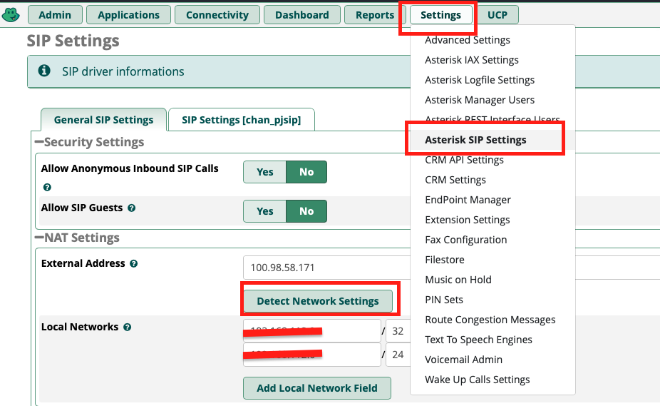
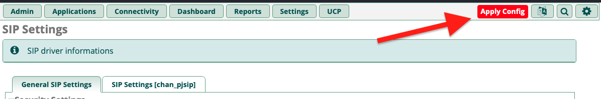

# No audio on freepbx after network or DNS change

# Introduction
If you have no audio on you freepbx server after changing the public ip, or dns you likely need to update your sip config.

# Test Echo
Open your sip application and test echo by dialing
```bash
*43
```

If this works, your freepbx installation is okay, and you can proceed with the next step.

# Set NAT external address
In Freepbx, click on "Settings" > "Asterisk SIP Settings" ,click on "Detect Network Settings" and then click on "Submit".
{: style="width:150:px"}

This will update your external WAN address.

Click on "Apply Config".
{: style="width:150:px"}

Now you should be able to use your sip cient, and you should be able to hear the person you are calling, and they should be able to hear you.

